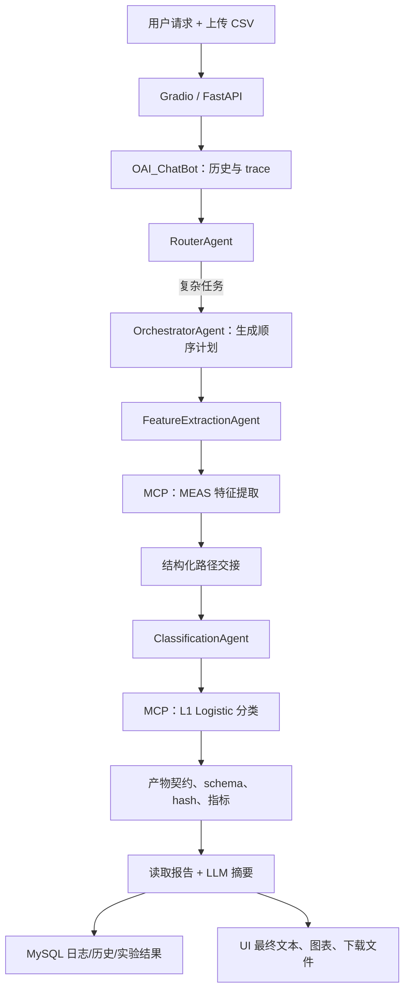

# OAI Agent System 多智能体系统结构化总结

> 审计口径：`[事实]` 表示材料直接说明或代码直接实现；`[推断]` 表示由实现行为得出的合理判断；`[缺失]` 表示仓库中没有足够证据。主要依据为 `README.md`、`src/agents/`、`src/server/`、`src/db_utils/`、`src/app.py`、`src/oai_client.py`、测试和现有运行产物。本总结只评价仓库材料，不把行业通行做法视为项目现状。

## 1. 项目概述

[事实] 这是面向膝骨关节炎（KOA）MRI 研究人员的交互式分析系统，提供影像分割、Radiomics/MEAS/LDSE 特征提取、特征质量评估、数据增强、KL 二分类、结果解释和网页搜索。典型场景是上传 MRI、掩膜或标签 CSV，串联“分割→特征→分类→报告”。依据：`README.md:1-14,42-92,227-248`。

## 2. 一句话架构

一个中心 Router 用 LLM 选择单个专用 Agent 或 Orchestrator，后者生成顺序计划并调用专业 Agent；专业 Agent 再通过 stdio MCP 子进程执行确定性医学影像/机器学习工具，结果与路径经共享状态、对话文本和 MySQL 日志回传。

## 3. 智能体清单

| 智能体 | 核心职责 | 输入 | 输出 | 可用工具 | 上下游关系 |
|---|---|---|---|---|---|
| `RouterAgent` | 意图识别，选择单 Agent 或多步编排 | 当前请求、最近 6 条消息、影像标志 | `agent/reasoning/confidence` 路由决策 | 无 | 上游为 LangGraph 入口；下游为 7 个节点。依据：`src/agents/router_agent.py:23-75,76-157` |
| `OrchestratorAgent` | 把复杂请求拆成有序步骤并串行调度 | 请求、最近 6 条消息、前序产物路径 | 计划、逐步结果、预生成的 `final_message` | 不直接调用 MCP；可调用分割、特征提取、分类、对话 Agent | Router 下游；四类子 Agent 上游。依据：`src/agents/orchestrator_agent.py:25-44,205-459` |
| `SegmentationAgent` | 选择 U-Mamba、LKM-UNet 或 LightM-UNet 完成 MRI 分割 | 请求、历史中的 `.nii.gz` 路径 | 分割文件路径及说明 | `umamba_segment_mri`、`lkm_unet_segment_mri`、`lightm_unet_segment_mri` | 可由 Router 直接调用，也可由 Orchestrator 调用。依据：`src/agents/segmentation_agent.py:24-80,89-188` |
| `FeatureExtractionAgent` | Radiomics、MEAS、LDSE 提取；显式请求时做增强或质量评估 | 标签 CSV、前序分割/增强产物、参数 | 特征 CSV、模型/manifest 路径、质量报告 | `extract_radiomics_features`、`meas_features_extraction`、`ldse_*`、`augment_*`、`assess_feature_quality` | 可接收分割/增强结果；向分类 Agent 交付特征文件。依据：`src/agents/feature_extraction_agent.py:35-192,200-424` |
| `ClassificationAgent` | L1 Logistic（项目称 LASSO）或 Filter 分类、组合特征分类、报告读取与 LLM 摘要 | 训练/测试特征 CSV、历史路径 | 指标、图表、特征、manifest、报告摘要 | `koa_lasso_classification`、`koa_filter_classification`、`read_classification_results`，提示中还声明组合与质量工具 | 常为流水线末端；把结果交给 UI/Orchestrator。依据：`src/agents/classification_agent.py:63-180,187-675` |
| `FeatureCombinationAgent` | 按区域或全局组合 Radiomics 特征 | 多个特征 CSV、区域/键列参数 | 组合 CSV 目录 | `combine_radiomics_features_by_region`、`combine_radiomics_features_all` | Router 可直接调用；**未接入 Orchestrator 子 Agent 映射**。依据：`src/agents/feature_combination_agent.py:24-101,109-226` |
| `WebSearchAgent` | 构造智谱搜索请求并由 LLM 总结结果 | 搜索问题、最近 6 条消息 | 搜索摘要和原始工具结果 | `web_search` | Router 可直接调用；**未接入 Orchestrator 子 Agent 映射**。依据：`src/agents/web_search_agent.py:24-76,83-290` |
| `ConversationAgent` | 普通对话、流程与结果解释、临床边界提示 | 当前问题、最近 20 条消息 | 自然语言回答 | 无 | Router 或 Orchestrator 的终端角色。依据：`src/agents/conversation_agent.py:19-83,90-128` |

[事实] 上表是“提示层意图权限”。实际执行层没有按 Agent 配置工具白名单：`MCPToolManager.call_tool()` 只检查工具是否已注册，因此任一专业 Agent 只要生成已注册工具名，技术上都可调用全部 MCP 工具。依据：`src/agents/tool_manager.py:75-92,119-176`。

## 4. 协作与编排机制

### 架构性质

[事实] 系统采用**集中式、分层式编排**：LangGraph `StateGraph` 固定从 Router 开始，简单任务路由到一个 Agent 后立即 `END`；复杂任务进入 `OrchestratorAgent`，由其在内部按计划串行调用子 Agent。专业 Agent 不直接彼此通信。依据：`src/agents/orchestrator.py:65-109`、`src/agents/orchestrator_agent.py:302-367`。

[推断] 它构成“逻辑上的多智能体系统”，因为存在多个独立 LLM 角色、提示词和执行节点；但不是自治群体或对等协商网络，更准确地说是“LLM 路由器 + LLM 顺序规划器 + 专用工具代理”的层级流水线。多智能体的主要价值是隔离专业提示上下文、处理跨工具依赖；仓库没有单 Agent 对照或消融实验，尚不能证明其效果优于单 Agent/确定性工作流。

### 分工、通信、状态与交接

- [事实] Router 输出 JSON 路由；Orchestrator 输出 `steps[]` JSON，Python `for` 循环依次执行，未实现并行调度。依据：`src/agents/router_agent.py:61-75`、`src/agents/orchestrator_agent.py:107-166,306-367`。
- [事实] 跨 Agent 交接依靠 `tool_results` 中的结构化路径：`parse_tool_result_paths()` 提取后，以 `FILES GENERATED BY PREVIOUS STEPS` 文本块注入下一步。依据：`src/agents/orchestrator_agent.py:174-203,326-333`；相关路径/交接测试位于 `tests/test_agent_feature_paths.py`、`tests/test_tool_result_handoff.py`。
- [事实] 单次图运行的共享状态是 `AgentState`，包含消息、当前输入、Agent、工具调用/结果、路由置信度和 `trace_id`。依据：`src/agents/state.py:8-21`。
- [事实] 长期对话存入 MySQL；超过 2 个完整轮次后，较早内容由 LLM 压成 JSON 摘要，只保留最近 2 轮原文。依据：`src/oai_client.py:107-255,272-324`。
- [事实] LangGraph 使用进程内 `MemorySaver`，但所有请求共用固定 `thread_id="1"`。依据：`src/agents/orchestrator.py:39-43,108-109,281-283`。
- [推断] 固定 thread ID、进程级全局 `global_chatbot/current_user` 与线程本地而非任务本地的请求上下文，使并发多用户状态隔离存在高风险；是否已发生串话需要并发测试确认。依据：`src/app.py:21-31,335-365`、`src/db_utils/db_utils.py:10-54`。

### 规划、调度、终止、汇总与冲突处理

| 职能 | 当前负责人 | 实现情况 |
|---|---|---|
| 路由 | `RouterAgent` | LLM 决策，低温度；无规则兜底或路由真值校验 |
| 规划 | `OrchestratorAgent` | LLM 生成顺序 JSON 计划；JSON 失败时退化为空步骤和原始文本 |
| 调度 | `OrchestratorAgent.process()` | Python 串行循环；无并发、优先级、队列、预算或最大步数 |
| 终止 | LangGraph 固定 `END`；多步任务以 `for` 循环结束 | 不存在图循环，因此通常不会图级死循环；但没有执行时限和计划长度上限 |
| 汇总 | 专业 Agent 拼接工具结果；Orchestrator 拼接各步结果 | Orchestrator 的 `final_message` 在执行前由规划 LLM 生成，不是基于实际结果重新汇总 |
| 冲突解决 | 无专门 Verifier/Supervisor | 没有多 Agent 投票、证据仲裁或人工裁决；路径冲突主要靠确定性解析规则 |

### 失败与重试

[事实] 工具管理器捕获异常并返回字符串；大多数 Agent 继续后续工具。Orchestrator 也捕获步骤异常、记录失败后继续执行。没有通用自动重试、指数退避、幂等键、取消或恢复检查点。依据：`src/agents/tool_manager.py:145-176`、`src/agents/orchestrator_agent.py:369-424`。

[事实] 存在严重状态语义缺陷：步骤失败时任务先被标为 `failed`，循环结束后又无条件更新为 `completed`；未知 Agent 也会 `continue`。依据：`src/agents/orchestrator_agent.py:315-322,369-443`。

[事实] MCP 调用只要传输层未抛异常就记为 `success`，即使工具返回 `{"status":"failed"}`；专业 Agent 又常把错误字符串包装成正常返回，因此 `agent_execution_log.success` 可能高估成功率。分类 Agent 对分类状态有额外检查，是局部例外。依据：`src/agents/tool_manager.py:121-183`、`src/agents/classification_agent.py:529-652`。

## 5. 核心执行流程

典型任务：“分别从训练集和测试集提取 MEAS 特征，然后用 LASSO 分类并读取报告”。

1. [事实] 用户在 Gradio 上传 CSV；应用复制到共享 `user_upload_file`，把真实路径拼入请求并记录到 `user_files`。依据：`src/app.py:123-178,369-396`。
2. [事实] `OAI_ChatBot` 将 MySQL 历史转换为 LangChain 消息，设置用户、会话和 trace 上下文，调用多智能体入口。依据：`src/oai_client.py:272-321`。
3. [事实] Router 读取请求和最近上下文，选择 `ORCHESTRATOR_AGENT`。依据：`src/agents/router_agent.py:76-157`。
4. [事实] Orchestrator 生成两步计划：`FEATURE_EXTRACTION_AGENT` → `CLASSIFICATION_AGENT`，并把计划写入 `tasks.plan_json`。依据：`src/agents/orchestrator_agent.py:141-149,244-298`。
5. [事实] 特征 Agent 解析真实 CSV，修复不安全/不完整计划，调用 MCP 的 `meas_features_extraction`；MCP 子进程执行算法并返回结构化输出路径。依据：`src/agents/feature_extraction_agent.py:252-397`、`src/agents/feature_plan_utils.py`。
6. [事实] Orchestrator 提取前一步 CSV 路径并注入分类步骤；分类 Agent 优先使用当前任务路径，调用 `koa_lasso_classification`。依据：`src/agents/orchestrator_agent.py:326-359`、`src/agents/classification_agent.py:500-585`。
7. [事实] 分类工具完成患者级嵌套分组交叉验证、锁定训练 schema、计算指标并发布 manifest、系数、图表等产物；成功后 Agent 才读取报告并让 LLM 摘要。依据：`src/algorithm/feature_class_algorithm/leakage_safe_l1_logistic.py`、`classification_artifacts.py`、`src/agents/classification_agent.py:575-630`。
8. [事实] 路由、Agent、工具、任务步骤及实验指标可写入 MySQL，UI 流式展示文本并解析图表/下载文件。依据：`src/db_utils/db_utils.py:113-278`、`src/app.py:402-453`。

## 6. 技术架构

| 层 | 组件 | 作用与证据 |
|---|---|---|
| LLM | 默认 `gpt-4.1-mini`，OpenAI-compatible `ChatOpenAI`；专业 Agent 温度 0.1，对话 Agent 0.7 | 路由、规划、参数生成、总结。`src/agents/config.py:15-85` |
| 记忆摘要/旧单 Agent | `OAI_ChatBot` 默认模型 `gpt-5.1`，OpenAI Python SDK | 历史压缩和兼容旧模式。`src/oai_client.py:28-40,158-255`。与专业 Agent 的 `MODEL_NAME` 默认值不同 |
| Agent 框架 | LangGraph、LangChain | 状态图、消息与 Prompt 组合。`src/agents/orchestrator.py:13-18,65-109` |
| 工具协议 | MCP `ClientSession` + `FastMCP`，stdio 子进程 | 发现并调用三个工具服务器。`src/server_config.json`、`src/agents/tool_manager.py:28-100` |
| 医学影像/ML | U-Mamba、LKM-UNet、LightM-UNet 外部分割服务；PyRadiomics、MEAS、LDSE、scikit-learn、SHAP、MONAI、SimpleITK、Torch | 分割、特征、增强、分类和解释。`README.md:42-85`、`pyproject.toml` |
| 外部搜索 | 智谱 `ZhipuAiClient` / `search_pro` | 实时网页搜索。`src/server/web_search_server.py:21-92` |
| 数据库 | MySQL / PyMySQL | 用户、会话、消息、任务、步骤、路由、工具、Agent 和实验结果。`src/db_utils/db_utils.py:57-310` |
| 消息/状态 | Python 字典/TypedDict、LangChain Message、进程内 MemorySaver、MySQL | 单次状态、上下文与持久历史；没有独立消息队列。`src/agents/state.py`、`src/agents/orchestrator.py:39-43` |
| 前端/接口 | Gradio 挂载到 FastAPI，Uvicorn | 登录/注册、聊天、上传、流式进度、图表和下载。`src/app.py:509-798` |
| 部署 | 单 Python 进程 + MCP 子进程 + MySQL + 单独启动的本地分割 HTTP 服务 | README 要求在 `src/` 下启动；未见 Docker、Kubernetes、反向代理、队列或生产部署清单。`README.md:209-218,290-295,355-359` |

[文档—实现不一致]

- `pyproject.toml` 声明 Python `>=3.12`，但 README 称在 3.11.7 验证，现有分类 manifest 记录 Python 3.10.20；正式运行基线不统一。
- README/Prompt 将三种分割模型描述为可同时选择，但三个 MCP 函数都请求同一个 `http://localhost:8000/predict/`，没有模型参数或不同端口；实际模型取决于当时外部启动的是哪个服务，无法由工具名独立保证。依据：`src/server/auto_experiment_server.py:72-207`。
- README 的多步能力覆盖特征组合，但 `OrchestratorAgent.agents` 不包含 `FEATURE_COMBINATION_AGENT` 和 `WEB_SEARCH_AGENT`；“组合→分类”等跨域请求可能被路由到编排器后无法执行。依据：`src/agents/orchestrator_agent.py:32-44`。
- `ClassificationAgent` 提示中组合工具参数写成 `csv_path/output_dir`，服务器真实 schema 是 `feature_files/output_root/...`；LLM 按提示生成时可能参数校验失败。依据：`src/agents/classification_agent.py:80-90`、`src/server/lasso_class_features_server.py:30-124`。
- README 称使用 FastAPI Session 登录，但 `/set_session?username=...` 可直接写 session，`/chat_ui` 又直接挂载；实现不构成可靠身份认证。依据：`src/app.py:695-795`。
- `pyproject.toml` 未直接声明代码实际导入的 `fastapi`、`uvicorn`、`pymysql`、`requests`、`pyradiomics`、`nest_asyncio` 等，README 用手工安装补充，环境复现存在缺口。

## 7. 关键设计决策

1. **中心路由 + 专业 Agent 分工。** [事实] 不同角色有独立提示与温度。收益是降低单次提示的工具选择复杂度；代价是多次 LLM 调用、额外延迟，以及错误路由造成能力不可达。尚无单 Agent 基线证明净收益。
2. **LLM 负责计划，确定性代码负责重型算法。** [事实] Agent 只生成 JSON 工具计划，真实分割/特征/分类由 MCP 服务执行。收益是自然语言灵活性与算法可测试性兼得；代价是 LLM 计划缺少强 schema、白名单和状态机约束。
3. **用文件路径作为跨步骤数据契约。** [事实] 前序结果解析成路径再注入后续 Agent。收益是适合大体积影像和 CSV，不把数据塞入上下文；代价是路径解析脆弱、权限边界宽、产物类型与版本表达不足。
4. **研究算法层优先防数据泄漏与可复现。** [事实] LDSE 只在训练集拟合，分类采用患者分组嵌套 CV、锁定 schema、输入 SHA-256、原子产物和 manifest。收益是科研可信度明显高于简单脚本；代价是实现复杂、执行耗时更高。依据：`src/algorithm/KOA_feature_extraction/ldse_feature_extraction.py`、`src/algorithm/feature_class_algorithm/*`。
5. **对话长历史采用 LLM 摘要。** [事实] 仅保留最近 2 轮。收益是控制上下文长度；代价是摘要可能丢失约束、路径或把不可信内容长期化，且原消息被数据库替换，审计原文不完整。依据：`src/oai_client.py:158-255`。

## 8. 质量与安全机制

### 已实现

- [事实] 分类与 LDSE 有较强的输入校验、训练/测试隔离、患者分组、防路径穿越、非安全 pickle 拒绝、输入哈希、随机种子、schema/manifest 和原子发布。依据：`src/algorithm/KOA_feature_extraction/ldse_feature_extraction.py:273-780`、`classification_artifacts.py:122-339`、`classification_output_contract.py`。
- [事实] Feature/Classification Agent 拒绝常见占位路径，分类失败后不会继续读取报告。依据：`src/agents/feature_extraction_agent.py:343-396`、`src/agents/classification_agent.py:529-652`。
- [事实] `trace_id` 串联路由、Agent、工具和步骤日志；错误可分类，已有只读分析 SQL。依据：`src/db_utils/db_utils.py:10-54,113-278`、`src/db_utils/error_categorizer.py`、`analysis_queries.py`。
- [事实] Conversation Prompt 明确研究/辅助边界，不提供诊断、处方或治疗决策。依据：`src/agents/conversation_agent.py:25-66`。

### 关键缺口

- [事实] 没有确定性权限控制平面、按角色工具 allowlist、路径沙箱或网络目的地白名单；权限主要靠 Prompt 自律。
- [事实] 没有人工审批门，工具可直接读写本地路径，分割工具会向 HTTP 服务发送影像，所有本地输出也直接发布。
- [事实] 未见对网页/工具输出的提示注入隔离；搜索结果原文直接拼入新的 LLM Prompt。依据：`src/agents/web_search_agent.py:169-243`。
- [事实] 数据库连接配置包含明文凭据，Session secret 硬编码为弱占位值；密码使用无盐 SHA-256，不适合作为密码哈希。为避免泄露，本总结不复述凭据。依据：`src/db_utils/db_config.json`、`src/app.py:699-700`、`src/db_utils/db_utils.py:335-351`。
- [事实] 上传文件按原始 basename 写入共享目录，可覆盖同名文件；未见文件类型、大小、恶意内容、用户目录隔离、加密、保留期或删除策略。依据：`src/app.py:123-178`。
- [事实] 工具日志保存完整参数和结果摘要，可能包含患者文件路径；未见脱敏/DLP。依据：`src/agents/tool_manager.py:142-143,185-215`。
- [缺失] 未发现 IRB/伦理、患者数据分类、去标识化、访问审计不可篡改、密钥轮换、事故响应、渗透测试或临床验证材料。

### 当前评估能力

| 维度 | 当前可观测性 | 结论 |
|---|---|---|
| 准确性 | 分类产物含 AUC、PR-AUC、Accuracy、Sensitivity、Specificity、F1；样例 manifest 的测试 AUC 约 0.683（98 人） | 这是单次 ML 实验结果，不是 Agent 系统准确性，也不足以证明泛化或临床有效性 |
| 任务完成率 | `tasks`/`task_steps` 和 `ORCHESTRATOR_COMPLETION` SQL | 受“失败后覆盖为 completed”和工具业务失败记 success 影响，当前完成率不可直接信任 |
| 路由准确率 | 有所谓 routing accuracy SQL | 该 SQL 比较“Router 选择”与“实际执行节点”，后者本来就由前者决定，没有人工真值，不能衡量路由正确性。依据：`src/db_utils/analysis_queries.py:16-52` |
| 延迟 | 记录请求总耗时、Agent 总耗时、工具耗时 | 可做均值/最大值；无 P50/P95 现成报表，`llm_latency_ms` 字段未见实际赋值 |
| 成本 | [缺失] 未记录 token、模型单价、GPU/CPU、存储或人工复核成本 | 无法计算单任务成本或质量—成本权衡 |
| 人工干预率 | [缺失] 没有审批、人工纠错、重跑原因或升级记录 | 无法量化人工接管率和节省时间 |
| 自动测试 | 本次在可用环境中执行 387 项测试，全部通过 | 完整套件仍有 3 个测试文件无法收集：环境缺 `monai`、`langchain_core`；仓库 `.venv` 失效。故不能声明全量测试通过 |

## 9. 优势、局限与风险

### 已实现的优势

- 专业角色、工具和医学影像任务边界清楚，普通问答与重型实验执行分离。
- 路径交接、LDSE 训练工件和分类产物已有较系统的确定性校验与测试。
- 分类管线重视患者级分组、训练/测试泄漏防护、嵌套 CV 和可复现 manifest，科研方法质量是当前最成熟部分。
- MySQL trace、步骤、工具和实验表为后续可观测性建设提供了基础。
- UI 覆盖上传、进度、图表、下载和对话历史，具备端到端原型形态。

### 当前局限

- 多智能体协作实质为串行调度；无并行、动态重规划、独立验证、冲突仲裁或可恢复检查点。
- Orchestrator 能调用的角色少于 Router/README 声明的角色，多步能力不闭环。
- 状态、错误和成功语义不一致，现有运营指标可能“看起来成功但实际失败”。
- LLM 输出只做宽松 JSON 提取，没有严格 Pydantic 计划契约、语义校验、工具白名单或预算限制。
- MemorySaver 非持久化且 thread ID 固定；上下文摘要会覆盖早期原始消息。
- 部署依赖工作目录和手工启动的外部服务，缺少容器、健康检查、版本锁定与运维清单。

### 潜在技术或产品风险

- **高：多用户越权与数据串扰。** 可伪造 username session、共享全局状态/上传目录和固定 LangGraph thread。
- **高：任意路径读写与数据外泄。** 用户/LLM 可影响工具路径，工具网关不限制目录，分割影像会发送到外部 HTTP 服务。
- **高：错误完成与科研误判。** 失败可能被记录为成功，预生成 final message 可能在执行失败后仍声称完成。
- **高：临床误用。** 只有对话提示声明非诊断用途，UI 与其他 Agent 没有统一的强制免责声明或发布审批。
- **中高：提示注入。** 搜索内容、历史摘要和工具输出被直接送入 LLM，可能改变后续计划或诱导越权工具调用。
- **中：模型/服务身份不确定。** 三个分割工具共用同一端点，输出无法可靠证明由哪个模型产生。
- **中：可用性与成本失控。** 无工具超时、计划步数/Token/费用上限、取消和通用重试；大计划可能长时间占用单进程。

## 10. 改进建议

| 优先级 | 发现的问题 | 建议的改动 | 预期收益 | 难度 |
|---|---|---|---|---|
| 高 | 登录可绕过、弱 Session secret、无盐 SHA-256、明文 DB 凭据 | 删除查询参数登录；使用服务端认证和 `Argon2id/bcrypt`；Session secret/DB 密码进密钥管理；增加用户级文件目录与授权检查 | 阻断账号冒用和跨用户数据泄露 | 中 |
| 高 | Agent 只有 Prompt 权限，工具可访问任意路径 | 增加非 LLM 控制平面：每个 Agent 工具 allowlist、Pydantic 输入/输出、工作区路径规范化、网络目的地白名单；默认拒绝 | 形成真正的最小权限边界 | 高 |
| 高 | 失败被覆盖为完成、业务失败记成功 | 定义 `pending/running/succeeded/failed/blocked/cancelled` 状态机；解析 MCP 结构化 `status`；任一必需步骤失败即停止并禁止 success final；修正统计 SQL | 完成率和告警可信，可避免错误科研结论 | 中 |
| 高 | 无超时、重试、幂等与恢复 | 为 LLM、HTTP、MCP、算法任务设硬超时；仅对幂等瞬时错误做有限退避重试；为输出操作加 run/operation ID、检查点和安全恢复 | 降低卡死、重复执行和半成品风险 | 高 |
| 高 | 多租户状态共享 | LangGraph `thread_id` 改为用户/会话/run ID；用 `contextvars.ContextVar` 代替 `threading.local`；移除进程级单用户全局变量 | 支持安全并发和可靠追踪 | 中高 |
| 高 | 没有独立结果校验，final message 预先生成 | 新增确定性 Verifier：检查工具状态、必需产物、hash/schema、指标一致性；执行结束后再基于验证结果生成最终摘要 | 防止“流畅但错误”的完成声明 | 中 |
| 中 | Orchestrator 角色集合不完整、工具参数文档不一致 | 将 Feature Combination/Web Search 正式接入，或让 Router 禁止把相关复合任务送入 Orchestrator；从 MCP schema 自动生成 Agent 工具说明 | 让声明能力与可执行能力一致 | 中 |
| 中 | 跨步骤只传文本路径 | 定义版本化 `ArtifactRef`/`StepResult`：类型、路径、hash、producer、schema、状态、数据级别；拒绝模糊文本交接 | 提高可靠性、可追溯性和重跑能力 | 中高 |
| 中 | 无可信系统评估 | 建立冻结任务集和人工真值：路由准确率、端到端完成率、错误完成率、产物数值一致性；与单 Agent/普通工作流做配对对照并报告置信区间 | 证明多 Agent 是否值得其延迟和成本 | 中 |
| 中 | 缺少提示注入和隐私防护 | 将检索/工具内容标为不可信数据；禁止其修改策略/工具/目的地；做注入、越权、路径穿越、跨会话和敏感信息外泄测试 | 降低恶意内容导致的越权和泄露 | 高 |
| 中 | 依赖和部署不可复现 | 补齐直接依赖并统一 Python 版本；容器化 app/MCP/分割服务/MySQL；加入健康检查、模型版本/权重 hash 和 CI 全量测试 | 降低环境漂移与上线故障 | 中 |
| 低 | 独立任务也完全串行 | 在状态和权限修复后，仅对无依赖、只读或隔离输出的步骤并行，设置并发上限 | 降低多模型/多数据集任务延迟 | 中 |
| 低 | 成本不可见 | 记录每次 LLM token、模型/工具/GPU 时间、存储和人工复核时间，建立预算与告警 | 支持模型选择和单位任务成本优化 | 低中 |

## 11. 信息缺口

- [缺失] 生产环境拓扑、并发用户数、SLA、实际启动脚本、反向代理/TLS、容器和备份恢复方案。
- [缺失] 精确 LLM 提供方、线上实际模型版本、上下文窗口、速率限制、token/价格记录及数据保留政策。
- [缺失] U-Mamba/LKM-UNet/LightM-UNet 的权重版本、训练数据、验证集、Dice/Hausdorff 等性能和模型服务身份证明。
- [缺失] 数据来源、许可、患者去标识化、IRB/伦理审批、跨境/第三方 API 数据处理协议。
- [缺失] Agent 系统的冻结评测集、路由人工真值、端到端成功标准、人工纠错记录、P50/P95 延迟、成本和干预率。
- [缺失] 单 Agent、确定性工作流与当前多 Agent 的消融/配对比较。
- [缺失] 并发、长上下文、提示注入、路径越权、服务中断、断点恢复、重复提交和数据库故障测试结果。
- [缺失] 角色/RBAC、审批人、发布负责人、事故响应和临床使用边界的组织制度。
- [缺失] 无法在当前环境执行的增强与 Agent 执行测试结果；需修复 `.venv` 并安装锁定依赖后跑完整 CI。

## 12. 管理层摘要

- 项目已形成可工作的 KOA MRI 研究自动化原型，端到端覆盖分割、特征、分类、报告和交互，价值定位清晰。
- 它是真正的“多角色 LLM 系统”，但协作深度仍是中心路由下的串行工具流水线；多 Agent 相对简单方案的增益尚未被实验验证。
- 最成熟的资产不是 Agent 编排，而是 LDSE/L1 Logistic 的训练—测试隔离、患者级验证、产物契约、hash 和可复现 manifest。
- 当前日志与实验表具备可观测基础，但成功/失败语义和路由准确率算法有缺陷，不能直接作为经营或质量 KPI。
- 身份认证、租户隔离、密钥、文件权限、提示注入和人工审批存在高风险缺口，不适合直接部署为多用户生产系统。
- 缺少统一超时、有限重试、幂等、检查点和独立 Verifier；失败时可能继续运行并最终显示“完成”。
- 建议继续投入，但下一阶段应优先完成安全控制平面、可信状态机、多租户隔离和端到端评估，而不是继续增加 Agent 数量。
- 在上述高优先级问题修复并完成独立验证前，适合受控的科研开发/演示环境，不适合临床决策或处理未充分治理的患者数据。
