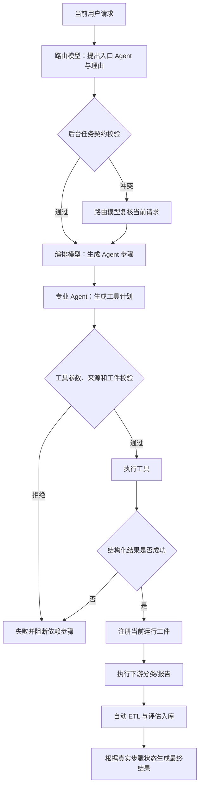

# KL 分级多智能体系统优化总结与自动优化路线图

> 更新日期：2026-08-09  
> 适用范围：分割、特征提取、特征组合、KL/OA 分类和分类报告读取等研究工作流。  
> 边界：本文讨论的是研究自动化和实验优化，不授权自主临床诊断、治疗建议或患者级临床决策。

## 1. 本轮优化目标

本轮修改主要解决四类问题：

1. 历史任务轨迹虽然存在，但缺少稳定的实验指标入库、工件谱系和策略比较基础。
2. 同一会话中的前一个任务会污染当前任务，例如请求 MEAS 时错误沿用 LDSE 特征。
3. 工具实际失败后，Agent 和编排器仍可能继续执行下游步骤并宣布任务完成。
4. 路由和最终状态中存在固定文案，不能准确反映大模型理解结果和真实执行结果。

## 2. 已完成的优化

### 2.1 轨迹、指标和工件数据闭环

系统已经建立用于离线分析和策略比较的数据层：

| 数据对象 | 用途 | 当前状态 |
|---|---|---|
| `trajectory_events` | 保存路由、计划、步骤、工具和评估事件 | 已实现 |
| `agent_execution_log` | Agent 级耗时、成功与失败记录 | 已实现 |
| `task_steps` | 编排步骤及每步状态 | 已实现 |
| `experiment_results` | LASSO/Filter 等分类指标结构化入库 | 已实现 |
| `artifact_registry` | 实验工件、内容哈希和谱系 | 已实现 |
| `evaluation_results` | 版本化指标和硬门槛结果 | 已实现 |
| `policy_versions` | 路由/编排策略版本及生命周期 | 已实现 |
| `routing_feedback` | 人工、规则或仲裁产生的路由参考标签 | 已实现表结构和接口，标签仍需独立产生 |

每次请求使用 `trace_id/run_id` 串联路由、Agent、工具、步骤、实验结果和评估结果，使一次任务可以从用户输入追踪到最终工件。

相关实现：

- `src/db_utils/db_utils.py`
- `src/db_utils/trajectory.py`
- `src/db_utils/analysis_queries.py`
- `src/db_utils/error_categorizer.py`

### 2.2 分类结果自动 ETL

成功执行 `koa_lasso_classification` 或 `koa_filter_classification` 后，工具管理器会自动触发当前运行的 ETL：

1. 只接受结构化且 `status=success` 的分类结果；
2. 校验工具返回目录必须是本次请求指定目录或其子目录；
3. 只扫描当前分类运行，避免导入其他历史实验；
4. 幂等写入 `experiment_results`、`artifact_registry` 和 `evaluation_results`；
5. 写入 `evaluation_ingestion_completed` 或失败事件；
6. ETL 失败不会删除已经产生的分类工件，可后续恢复导入。

因此，新产生的分类实验通常不再需要人工执行 ETL。历史结果或异常恢复仍可运行：

```powershell
Set-Location src
python -m db_utils.experiment_etl --root task_results_history
```

`routing_feedback` 不由分类 ETL 自动生成，因为实际执行的 Agent 不能同时充当自己的路由正确性标签。它应来自人工、确定性规则或独立仲裁器。

相关实现：

- `src/agents/tool_manager.py`
- `src/db_utils/experiment_etl.py`

### 2.3 当前任务与历史记忆隔离

系统现在明确区分两类信息：

- 会话记忆：用于理解“刚才”“上一次”等自然语言指代；
- 可执行工件：分类工具真正可以使用的训练集和测试集特征文件。

主要约束如下：

1. 每个用户请求生成独立 `run_id/trace_id`。
2. LangGraph 使用会话级 `thread_id`，同时使用请求级 `checkpoint_ns` 隔离执行状态。
3. 当前输入生成 `TaskSpec`，记录特征类型、是否提取、是否分类、是否读取报告和是否允许历史复用。
4. 新提取任务默认禁止复用历史特征。
5. 只有用户明确说“使用刚才的特征”“沿用上次结果”等，才允许进入历史工件复用流程。
6. 分类前校验工件的 `run_id`、特征类型、train/test 角色和路径。
7. 请求 MEAS 时不能使用 LDSE 工件，请求 LDSE 时也不能使用 MEAS 工件。

相关实现：

- `src/agents/task_contracts.py`
- `src/agents/state.py`
- `src/agents/orchestrator.py`
- `src/agents/orchestrator_agent.py`
- `src/agents/classification_agent.py`

### 2.4 MEAS 输入错误修复

此前出现 `Error executing tool meas_features_extraction: 'ImagePath'` 的根因不是原始标签 CSV 缺少 `ImagePath`，而是执行前的路径修复逻辑把 `labels_train.csv` 或 `labels_test.csv` 替换成了历史 LDSE 特征表。LDSE 特征表没有 `ImagePath/MaskPath`，因此 MEAS 提取器报错。

本轮已完成以下修复：

1. 新增源数据 CSV 与特征 CSV 的独立解析逻辑。
2. 特征提取工具只能接受标签/图像元数据 CSV，不能被历史特征表替换。
3. 分类和质量评估工具仍可使用生成的特征 CSV。
4. MEAS 训练集和测试集强制写入不同的 `_Train`、`_Test` 输出目录，防止互相覆盖。
5. MEAS 输入支持 `CaseID/ImagePath/MaskPath/KLGrade`，并兼容：
   - `case_id`
   - `image_path`
   - `mask_path`
   - `kl_grade`
   - `koa_grade`
6. 缺列时返回明确的缺失列和实际列名，不再只抛出难以定位的 `KeyError`。
7. MEAS 工具返回结构化的 `status`、`message`、`output_csv` 和处理计数。

相关实现：

- `src/agents/path_utils.py`
- `src/agents/feature_plan_utils.py`
- `src/agents/feature_extraction_agent.py`
- `src/algorithm/KOA_feature_extraction/meas_feature_extraction.py`
- `src/server/auto_experiment_server.py`

### 2.5 失败传播和下游阻断

过去 MCP 返回的错误字符串仍可能被 Agent 当成普通成功结果，造成：

- 页面先显示“完成”；
- 编排器继续执行 LASSO；
- 报告读取步骤读取到之前的 LDSE 报告；
- 最终输出与真实执行状态矛盾。

现在已经增加统一的工具结果判定：

- `Error executing tool ...`、`Tool execution failed ...` 等错误字符串判为失败；
- `status=failed/error` 或 `success=false` 的结构化结果判为失败；
- Agent 返回权威 `success=false` 和错误信息；
- 上游失败后，依赖步骤标记为 `skipped`，不会调用分类或报告工具；
- 分类和报告读取合并为同一个 `CLASSIFICATION_AGENT` 步骤，报告只能读取本次成功分类的输出目录；
- 任务终态根据实际步骤生成，区分 `success`、`failed` 和 `skipped`。

相关实现：

- `src/agents/tool_result_utils.py`
- `src/agents/feature_extraction_agent.py`
- `src/agents/classification_agent.py`
- `src/agents/orchestrator_agent.py`
- `src/agents/orchestrator.py`

### 2.6 移除误导性固定文案

已排查并处理以下输出：

| 原输出 | 来源 | 处理结果 |
|---|---|---|
| `Deterministic current-task contract override` | 路由代码固定文案 | 已删除 |
| `路由依据: 当前任务约束` | 路由代码固定文案 | 已删除 |
| 固定的“分析用户请求……” | 流式界面模板 | 已删除 |
| `✅ 任务处理完成` | 原先无条件输出 | 改为根据真实 `success` 输出 |
| “已完成训练集和测试集……” | LLM 在执行前生成的 `final_message`，代码无条件追加 | 不再把预执行总结作为完成证据 |

当前路由采用 LLM-first 模式：

1. 当前用户请求先交给路由模型；
2. 历史上下文只用于参考，不得替代当前请求；
3. 模型生成入口 Agent、置信度和 `reasoning`；
4. 如果后台校验发现提案破坏当前任务依赖，则将请求再次交给模型复核；
5. 页面展示模型生成的理由，而不是契约层固定文案；
6. 确定性控制层只负责验证、权限、状态和工件约束。

之后，`ORCHESTRATOR_AGENT` 的模型负责规划 Agent 顺序，各专业 Agent 的模型负责选择具体工具及参数。

相关实现：

- `src/agents/router_agent.py`
- `tests/test_router_llm_first_contract.py`

## 3. 当前执行流程



## 4. 测试与验证

截至本次修改：

- 最终相关回归测试：`64 passed`；
- 完整可执行测试集：`430 passed`；
- 额外运行环境冒烟测试覆盖：
  - 路由模型正常提案；
  - 路由冲突时进行模型复核；
  - MEAS 错误字符串传播为失败；
  - 上游失败后不调用分类 Agent；
  - 历史 LDSE 路径不会替换当前 MEAS 源 CSV；
  - MEAS train/test 输出目录隔离。

系统 Python 环境缺少 `monai` 和 `langchain_core`，因此三个依赖相关测试模块没有在该解释器中收集；项目运行环境已对关键 Agent 路径做额外冒烟验证。这些属于测试环境依赖限制，不是已执行测试失败。

## 5. 尚未实现的自动优化闭环

当前系统已经具备“可观测、可追踪、可离线比较”的基础，但还没有形成可安全上线的全自动策略学习闭环。建议采用以下原则：

> 2026-08-09 实施更新：P0 的任务级自动评价器和首批 20 条开发任务目录已经落地。评价器会自动写入任务成功、错误完成、跨运行工件违规、工具覆盖率及 8 个硬门槛。任务目录仍为 `draft`，尚未经过独立人工审核和冻结；离线回放器、影子运行和策略晋升仍未实现。

- 大模型负责提出路由、计划、工具和参数候选；
- 控制层负责校验、执行和记录权威状态；
- 自动优化器只能生成候选策略，不能直接修改线上策略；
- 候选策略必须经过冻结评估集、离线回放、影子运行和人工批准；
- 最终测试集只能用于最终评估，不能用于调参或策略选择。

## 6. 下一阶段建议及优先级

### P0：先形成可信的评价和回放闭环

#### 6.1 建立标准任务集和参考答案

为常见任务建立冻结任务集，例如：

- LDSE → LASSO → 报告；
- MEAS → LASSO → 报告；
- Radiomics → Filter；
- 分割 → 特征提取 → 分类；
- 明确复用历史工件；
- 禁止复用历史工件；
- 缺列、缺文件、工具超时和部分失败。

每个任务应包含：

- 期望入口 Agent；
- 允许的 Agent 顺序；
- 必须/禁止调用的工具；
- 输入工件类型和 train/test 角色；
- 期望输出工件；
- 成功条件和硬失败条件；
- 是否允许历史复用；
- 人工或规则产生的参考标签。

没有稳定参考集时，系统只能优化“看起来成功”，无法优化真正的任务完成质量。

#### 6.2 自动生成任务级评价结果

在现有表之上增加一个任务级 evaluator，自动计算：

- 所有必需步骤是否成功；
- 是否调用错误 Agent 或错误工具；
- 是否缺少 train/test 工件；
- 是否发生跨任务或跨特征类型复用；
- 是否产生错误的完成声明；
- 分类报告是否来自本次分类目录；
- 结果指标、耗时和重试次数；
- 自动 ETL 是否成功。

建议将以下项目设为硬门槛，任何一项失败都不得判定任务成功：

- 数据泄漏或跨任务工件污染；
- 上游失败后仍执行下游；
- 工具失败但任务宣布完成；
- 报告与本次分类运行不一致；
- 缺少必要工件或工件哈希不匹配。

#### 6.3 建立离线轨迹回放器

对历史任务保存脱敏后的输入、任务规范、模型版本、Prompt/策略版本和工具模拟结果，然后让候选策略重新完成：

- 路由；
- Agent 规划；
- 工具选择；
- 参数生成；
- 失败处理；
- 最终状态判断。

第一阶段只回放决策，不重新运行昂贵的影像算法；通过后再选择部分任务做真实重跑。

#### 6.4 完善独立反馈标签

`routing_feedback` 应逐步接入：

- 确定性规则标签：明显任务可以自动标注；
- 人工审核标签：复杂或冲突任务由审核者给出；
- 双人独立审核与仲裁：用于正式评估集；
- 用户纠正信号：用户主动改写、重试或指出错误，但不能直接当作唯一真值。

### P1：候选策略自动生成与安全比较

#### 6.5 路由策略优化

使用轨迹构建路由训练数据，输入可以包括：

- 当前任务文本嵌入；
- 是否包含分割、特征、分类、报告等操作；
- 操作依赖数量；
- 文件和工件类型；
- 当前 Agent/工具可用性；
- 历史同类任务成功率、延迟和成本。

可以按以下顺序迭代：

1. 规则加权和阈值优化；
2. 监督式路由分类器；
3. 上下文多臂老虎机，在影子模式中探索；
4. 只有积累足够数据后再考虑强化学习。

不建议直接用线上分类 AUC 作为路由奖励，因为它会混淆数据质量、算法表现和路由质量。

#### 6.6 Agent 计划和工具选择优化

从成功轨迹中提取可复用的任务 DAG 模板：

```text
MEAS pipeline:
source CSV validation
  -> MEAS train/test extraction
  -> artifact validation
  -> LASSO classification
  -> report read
  -> ETL/evaluation
```

对每种任务比较：

- 工具成功率；
- 参数完整率；
- 工件通过率；
- 平均/P95 延迟；
- token 和计算成本；
- 重试次数；
- 最终任务成功率。

优化器可以自动生成新的 Prompt、工具描述、DAG 模板或参数默认值作为候选版本，但不能直接覆盖当前线上版本。

#### 6.7 多目标奖励与硬门槛

建议采用“先硬门槛、后排序”的方式，而不是只计算一个总分：

第一层硬门槛：

- 无数据泄漏；
- 无错误完成；
- 必需工件完整；
- 输入输出 schema 合法；
- 评估集冻结；
- 安全和权限规则通过。

第二层候选排序：

```text
任务完成率 ↑
路由正确率 ↑
工件有效率 ↑
分类指标稳定性 ↑
人工纠正率 ↓
延迟与成本 ↓
```

分类 AUC、F1 等只能在相同数据划分和相同评估协议内比较。

#### 6.8 影子策略、灰度和回滚

候选策略的生命周期建议为：

```text
draft -> offline_replay -> shadow -> approved -> active -> retired/rolled_back
```

影子策略只生成决策，不实际控制工具。比较当前策略和候选策略在同一批任务上的：

- 成功/失败差异；
- Agent 和工具选择差异；
- 硬门槛差异；
- 成本和延迟差异。

只有满足预设阈值并经人工批准后，才激活精确的策略配置哈希。保留上一版本用于快速回滚。

### P2：运行时自适应和长期治理

#### 6.9 自动故障恢复

建立错误类别到恢复动作的受控映射：

| 错误类型 | 可自动动作 |
|---|---|
| 临时服务不可用 | 有界重试和退避 |
| 输入 schema 错误 | 阻断并返回缺失字段 |
| 工件路径不存在 | 从当前运行注册表重新解析，不查历史聊天文本 |
| 模型/工具不可用 | 切换到预先批准的备用工具 |
| 上游部分失败 | 使下游工件失效并停止 |
| 外部写入状态未知 | 禁止盲目重试，先对账或人工确认 |

重试必须有 `operation_id/idempotency_key`，避免重复执行昂贵算法或重复写入。

#### 6.10 数据、性能和行为漂移监测

持续监测：

- 用户任务类型分布变化；
- Agent 路由分布变化；
- 工具错误率和错误类型变化；
- 图像/标签/特征 schema 漂移；
- 分类指标和校准漂移；
- 延迟、成本和 token 漂移；
- 历史复用请求比例；
- 错误完成率和人工纠正率。

超过阈值时暂停自动晋升，回退到稳定策略并触发重新评估。

#### 6.11 自动消融和因果归因

为了判断改进来自哪里，应对候选版本做同任务配对消融：

- 仅修改路由 Prompt；
- 仅修改任务契约；
- 仅修改 Agent Prompt；
- 仅修改工具描述或默认参数；
- 仅修改模型；
- 单 Agent 与多 Agent 对比。

这样可以避免把数据集差异或随机波动误认为策略提升。

#### 6.12 安全与权限治理

后续如果系统扩展到数据上传、消息、仓库或外部平台写入，需要增加：

- Agent/工具最小权限白名单；
- 输入和工具结果的 Prompt Injection 隔离；
- 患者数据分级、脱敏和留存策略；
- 外部写入前的人工审批；
- 审批与 `run_id`、目标、工件哈希、有效期绑定；
- 追加式审计日志和异常告警。

## 7. 推荐的最近实施顺序

建议下一阶段先完成以下四个里程碑：

### 里程碑 A：任务级自动评价器

- [x] 定义首批 20 个代表性开发任务；
- [x] 为 Agent、工具和工件建立期望约束；
- [x] 自动计算任务成功、错误完成和串工件指标；
- [x] 将结果写入 `evaluation_results`；
- [ ] 由独立审核者确认参考答案并冻结目录哈希；
- [ ] 扩展到真实数据夹具和 50 个以上分层任务。

### 里程碑 B：离线回放与候选策略比较

- 保存脱敏输入和版本信息；
- 实现路由/规划决策回放；
- 输出当前策略与候选策略的配对差异报告；
- 不修改线上策略。

### 里程碑 C：影子运行

- 给同一任务同时运行 active 和 shadow 决策；
- shadow 不调用真实工具；
- 自动记录决策差异、成本和预计结果；
- 设置最小样本量和晋升阈值。

### 里程碑 D：人工批准的自动晋升与回滚

- 自动生成候选策略和评估报告；
- 人工批准精确配置哈希；
- 小流量灰度；
- 异常自动回滚；
- 保留全部策略和工件谱系。

## 8. 建议优先追踪的核心指标

| 指标 | 建议定义 |
|---|---|
| `task_success_rate` | 满足全部必需输出和硬门槛的任务比例 |
| `false_completion_rate` | 实际失败或缺少工件但输出“完成”的任务比例 |
| `cross_run_artifact_violation_rate` | 非授权使用其他运行工件的比例 |
| `routing_accuracy` | 与独立参考标签一致的路由比例 |
| `tool_success_rate` | 工具结构化成功次数 / 实际调用次数 |
| `artifact_validity_rate` | schema、类型、角色、哈希和路径全部通过的工件比例 |
| `reproducibility_rate` | 相同版本和输入下通过容差复现实验的比例 |
| `human_correction_rate` | 需要实质性人工纠正的步骤或任务比例 |
| `etl_success_rate` | 成功分类后评估数据自动入库的比例 |
| `latency_p50/p95` | 任务和各步骤端到端延迟 |
| `cost_per_successful_task` | 模型、计算、存储及人工审核总成本 / 成功任务数 |

## 9. 结论

本轮优化已经把系统从“主要依赖会话文本和模型自述”推进到“当前任务契约、运行级工件、结构化失败、自动 ETL 和可追踪评估”阶段。下一步不应直接让系统在线自我修改，而应优先建设标准任务集、任务级评价器、离线回放和影子策略。完成这四项后，系统才具备基于历史轨迹自动生成候选策略、可靠比较、人工批准上线和异常回滚的完整优化闭环。

### 2026-08-09：目标驱动自动规划更新

已新增 `GoalSpec`、数据画像、版本化 Pipeline 能力注册表、6 条 KL 候选流水线、历史任务可靠性排序、受控的大模型近似并列选择，以及自动候选物化执行。用户现在可以只输入“完成当前数据的 KL 分级任务”；系统会根据当前 train/test schema 和历史轨迹选择一条合法 Pipeline，而不要求用户指定 MEAS/LDSE 与 LASSO/Filter。

当前阶段只执行综合可靠性最高的 Top-1 候选；尚未在当前数据上执行多个候选并以无泄漏验证指标选择最终模型。现有分类工具也是 `KLGrade < 2` 与 `>= 2` 二分类，明确的 0–4 五分类请求会被阻断，不会被错误声明为完成。
